# Med-HALT End-to-End Flow

This guide follows the main experiment entry point, `run_casual_transfer.py`. It shows how raw benchmark examples become scored pairs, how the experiment chooses and evaluates interventions, and where the reported metrics come from.

## Flow chart

```mermaid
flowchart TD
    A[Start: choose model, tasks, seed, and run settings] --> B[Load task records from Med-HALT or Hugging Face]
    B --> C{Task type?}
    C -->|FCT or NOTA| D[Build clean and hallucination-style multiple-choice pair]
    C -->|PMID2Title or Title2URL| E[Build clean and counterfactual retrieval pair]
    D --> F[Tokenize prompts and candidate answers]
    E --> F
    F --> G{Can answers be scored at their first differing token?}
    G -->|No| H[Reject pair: tokenization or candidate alignment issue]
    G -->|Yes| I[Save pair: clean prompt, corrupt prompt, candidates, and labels]
    I --> J[Baseline pass: score clean and corrupt prompts without steering]
    J --> K[Record logits, correctness, margins, and activation snapshots]
    K --> L[Randomly reserve unfiltered held-out pairs before validation]
    L --> M[Validate remaining pool: clean must be correct; margins and task rules must pass]
    M -->|Invalid| N[Record rejection reason; exclude from conditioned splits]
    M -->|Valid| O[Split valid pairs into discovery, validation, and test]
    O --> P{Run analysis branches}

    P --> Q[Safe-layer branch]
    Q --> Q1[Build layer steering vectors from discovery pairs]
    Q1 --> Q2[Sweep layers and steering strengths on validation, test, and unfiltered sets]
    Q2 --> Q3[Select safe layer and strength using validation safety and benefit]
    Q3 --> Q4[Fit risk gate and threshold using validation data]
    Q4 --> Q5[Evaluate always-on and gated steering on test and unfiltered sets]

    P --> R[Component branch, unless --skip_components]
    R --> R1[Build head and MLP steering vectors from discovery pairs]
    R1 --> R2[Discover influential components and candidate circuits]
    R2 --> R3[Calibrate circuit size, method, and strength on validation pairs]
    R3 --> R4[Fit router on discovery/validation data]
    R4 --> R5[Evaluate transfer between source and target tasks on test pairs]
    R5 --> R6[Evaluate steering on unfiltered held-out pairs]

    Q5 --> S{Free generation enabled and a configuration selected?}
    R6 --> S
    S -->|Yes| T[Generate before/after answers; create audit sheet]
    T --> U[Optionally compare automatic labels with human audit labels]
    S -->|No| V[Skip generation stage]
    U --> W[Summarize accuracy, rescue, induced errors, uncertainty, and tests]
    V --> W
    W --> X[Write CSV/JSON results, plots, and cached state under output_dir]
```

## Steps in plain language

1. **Configure the run.** The script reads the model, task list, sample counts, random seed, split sizes, safety limits, steering strengths, and output folder. It sets random seeds and saves the configuration so a resumed run can check that its settings still match.

2. **Load benchmark records.** Each task is read from local Med-HALT data, the Med-HALT prompt utilities, or the configured Hugging Face dataset source.

3. **Build matched pairs.** Hallucination tasks (FCT and NOTA) become multiple-choice clean/corrupt prompts. Retrieval tasks (PMID2Title and Title2URL) become clean/counterfactual prompts. Candidate answer strings and their labels are attached to each pair.

4. **Align candidate tokens.** The tokenizer can split the same answer differently depending on its prompt. The code finds the shared answer prefix and scores the first token where candidate answers diverge. A pair is rejected if the answers cannot be aligned or their scored tokens collide.

5. **Run a no-intervention baseline.** The model scores both versions of every built pair. The baseline saves candidate logits, clean/corrupt correctness flags, score margins, and final-position activations. This pass is used for filtering, steering-vector construction, and later comparisons.

6. **Reserve an unfiltered set.** A seeded random fraction of all built pairs is held out **before** the validation filter. This set measures outcomes on examples regardless of whether the model initially answered the clean prompt correctly.

7. **Validate and split the remaining pool.** A pair is valid only if the clean answer is correct, its clean score margin is large enough, and the clean-versus-corrupt margin is large enough. Counterfactual tasks also require the corrupt prompt to prefer its expected alternate answer. Invalid pairs are logged with a reason. Valid pairs are divided into discovery, validation, and test sets.

8. **Build steering directions from discovery data.** For each layer/component, the code averages the clean activation minus the corrupt activation. Discovery examples are used to find directions and components; they are not used as the final test set.

9. **Choose configurations on validation data.** The safe-layer analysis sweeps layers and strengths, then selects a layer under the configured harm limit. The component analysis ranks components, compares circuit-building methods, and calibrates circuit size and steering strength. Risk routers and activation thresholds are also fit or selected using training/validation information.

10. **Evaluate held-out outcomes.** Selected configurations are evaluated on the conditioned test split and, separately, on the unfiltered held-out set. The code compares baseline, always-on steering, and risk-gated steering where available. It counts answers rescued and answers made incorrect, then computes confidence intervals and paired statistical tests.

11. **Optionally evaluate free generation.** If enabled and a configuration was selected, the model generates answers before and after intervention. Automatic answer labels are proxies; the run can create an audit sheet for human review and compare filled-in human labels with automatic labels.

12. **Save results.** The output folder contains configuration, pair-construction, validation and split records; safe-layer and component results; summaries and tests; optional generation/audit tables; plots; and resumable checkpoints.

## How to read clean accuracy and the filter

- **Pair validity** answers: “Does this pair meet the rules for inclusion in the conditioned analysis?” It is a filter decision, not accuracy.
- **Accuracy** is the mean of the correctness flags in the selected set: `number correct / number evaluated`.
- **`acc_clean_unfiltered`** uses the randomly reserved pairs before validation. It measures clean-answer accuracy without filtering on whether the clean answer was correct.
- **`acc_clean_conditioned_test`** uses the valid test pairs. Since validation requires `correct_clean == True`, this value is 100% when the split is nonempty. It is a consequence of the filter, not an independent model-performance estimate.
- **Corrupt accuracy** uses the correctness rule appropriate to each task: hallucination tasks retain the original correct answer as gold; counterfactual tasks use the intended alternate answer as gold.

## Main code locations

- `run_casual_transfer.py`: orchestration, pair construction, filtering, splitting, outputs, and optional generation.
- `experiment_runner.py`: baseline scoring, component discovery, router fitting, intervention evaluation, and statistical summaries.
- `safe_layer_steering.py`: layer sweeps, safety selection, gate evaluation, before/after tables, and plots.
- `patching_engine.py`: model loading, candidate scoring, activation capture, and intervention execution.

Other scripts such as `eval_downstream_all_models.py`, `eval_medhalt_softmax.py`, and `eval_downstream_softmax.py` are follow-on evaluation entry points that reuse saved selections or checkpoints; they are not stages automatically launched by `run_casual_transfer.py`.
